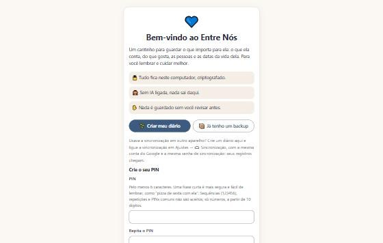
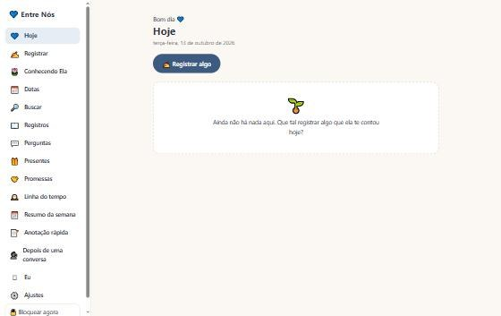

# Entre Nós

Diário de relacionamento que organiza o que a outra pessoa te conta e te lembra do que importa.
Você escreve em texto livre; o app extrai gostos, pessoas, datas, preocupações e o que ajuda,
relaciona com o que já foi registrado, antecipa datas e sugere gestos simples, sempre citando a
origem e sem inventar nada. Tudo fica criptografado no seu aparelho.

A ideia que guia o projeto: **entender melhor para cuidar melhor, não para controlar.**

## Por que ele é diferente

- **Funciona sem IA.** Um motor de regras em Python lê o texto e classifica cada item com um grau
  de certeza (confirmado, observado, inferência, incerto). Nada é gravado sem você revisar antes.
- **IA é opcional e sob demanda.** Só por botão, com o provedor que você quiser (URL, chave e
  modelo), com um provedor reserva e um PIN próprio para a tela de ajustes. Registros marcados
  como privados nunca saem do aparelho.
- **Um núcleo, dois ambientes.** O mesmo código Python roda no computador (servidor local) e no
  celular, dentro do navegador, via Pyodide num Web Worker. O app no celular é um PWA que funciona
  offline.
- **Privacidade por construção.** O diário inteiro vive num único arquivo `.cofre`: um SQLite em
  memória, serializado e cifrado com AES-256-GCM, chave derivada do PIN por scrypt. Bloqueio por
  inatividade, espera crescente depois de PIN errado e nenhum "esqueci o PIN": sem ele, ninguém
  abre, nem você.
- **Sincronização sem servidor próprio.** Opcional, pela pasta oculta do app no Google Drive, com
  senha de sincronização separada, um arquivo cifrado por aparelho e mescla com lápides.

## O que o app faz

| Área | O que tem |
|---|---|
| Registrar | texto livre, extração por regras, revisão antes de gravar, contexto e contradições |
| Hoje | alertas do dia com controle de excesso |
| Conhecendo | pessoas, preferências, como a pessoa está, lugares, marcos e linha do tempo |
| Datas e busca | datas que se repetem, "neste dia", busca em tudo |
| Recursos | perguntas para conversar, ideias de presentes, promessas, anotação rápida, diário de conversa com resumo da semana |
| Eu | check-in semanal e mensal, espelho dos próprios registros, aprendizados, cartas; nunca vai para a IA |
| Ajustes | PIN, bloqueio, backup e restauração, importação, IA, sincronização |

## Arquitetura

```
entrenos/            núcleo em Python puro (sem threads, rede ou Windows: precisa rodar no Pyodide)
  nucleo.py          toda a lógica atrás de Nucleo.tratar()
  regras/            datas, pessoas, categorias, certeza, itens
  motor.py           regras + IA plugável      banco.py / cofre.py   SQLite em memória + AES-256-GCM
  alertas.py perfil.py busca.py contexto.py provedores.py sincronizacao.py
  recursos/          um módulo por recurso, com esquema, rotas e cartões próprios
  servidor.py        transporte HTTP do computador (127.0.0.1)
  ponte.py           entrada JSON para o navegador
web/                 SPA sem framework, CSP estrita, telas/*.js, Web Worker com Pyodide, service worker
testes/              testes do núcleo (unittest) e do navegador (Node)
construir_web.py     monta o PWA em site/      construir_instalador.ps1 + instalador/   .exe (PyInstaller + Inno Setup)
```

Decisões técnicas e contratos entre módulos estão em [`DESIGN.md`](DESIGN.md).

## Demonstração

Versão para celular e navegador (PWA), rodando o mesmo núcleo Python dentro do navegador:
**https://entre-nos.divincere.workers.dev/**. Crie um diário de teste com um PIN qualquer; tudo
fica só no seu navegador, nada vai para servidor nenhum.

## Como rodar

Precisa de Python 3.14 e da biblioteca `cryptography`.

```bash
python iniciar.py
```

Abre em `http://127.0.0.1:8787`. Opções: `--sem-navegador`, `--porta N`, `--dados PASTA`.
No Windows, `Abrir Entre Nos.bat` faz o mesmo. Os dados ficam em `%LOCALAPPDATA%\EntreNos`,
nunca na pasta do código.

Testes do núcleo:

```bash
python -m unittest discover -s testes
```

O manual completo (instalador, antivírus, celular, sincronização, backup) está em
[`docs/MANUAL.md`](docs/MANUAL.md).

## Telas

| Primeiro uso | Hoje |
|---|---|
|  |  |

Capturas de um diário de demonstração vazio. Ao registrar um texto como "ela adora tulipas amarelas e a irmã dela, a Carla, vai visitar no dia 25", o app separa um gosto (confirmado), uma pessoa nova para você confirmar (Carla, irmã) e um acontecimento com data, cada um com categorias que você pode ajustar antes de salvar.

## Licença

MIT. Veja [`LICENSE`](LICENSE).
